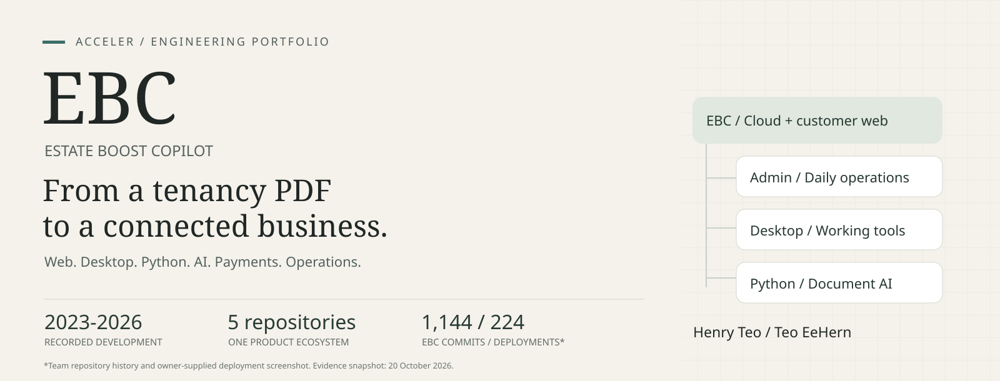
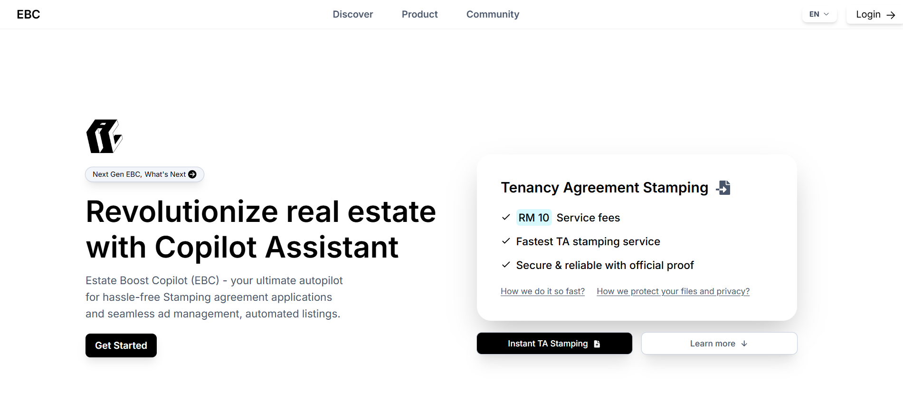
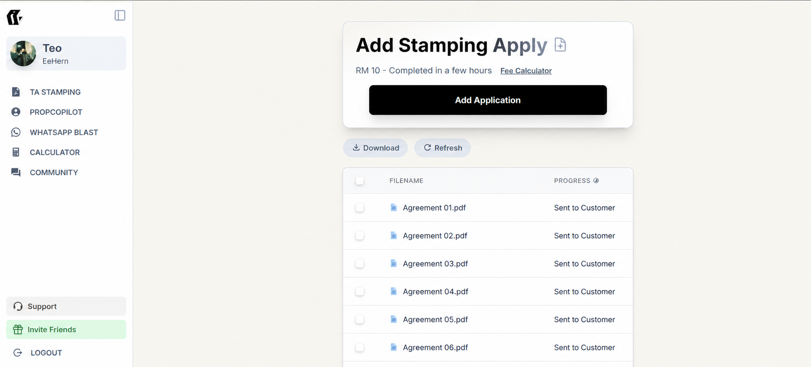
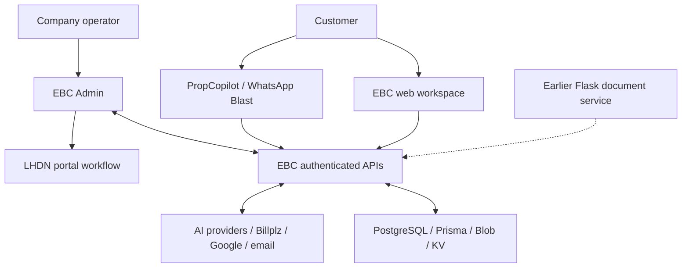
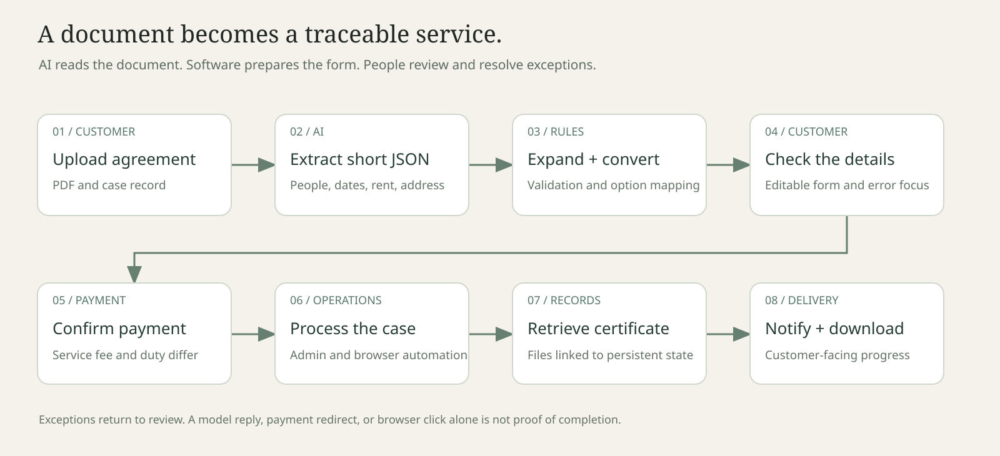

<h1 align="center">Estate Boost Copilot</h1>

<strong>A software ecosystem for property work, document processing, customer operations, and AI assistance.</strong>

An engineering portfolio by <a href="https://github.com/HenryTeo27">Henry Teo / Teo EeHern</a>, founder of ACCELER TECHNOLOGY. Built with a team. Developed across five connected repositories. Recorded history begins in 2023.

  <a href="#the-product">Product</a> ·
  <a href="#the-system">Architecture</a> ·
  <a href="#engineering-highlights">Engineering</a> ·
  <a href="#development-record">Evidence</a> ·
  <a href="docs/11-interview-guide.md">Interview guide</a>

> **Public showcase of private products.** This repository presents product screenshots, original architecture explanations, engineering case studies, and dated development evidence. Application source code, credentials, customer documents, and internal datasets remain private.

## Start here

I work on the full path from a customer problem to the software and operations that resolve it. In EBC, this means a customer-facing website, desktop applications, a Python document-processing service, an admin console, and the APIs that connect them.

A tenancy agreement, for example, must become usable data. That data must become a reviewable form. A paid application must enter an operational workflow. Its certificate must return to the customer. Errors, missing fields, provider failures, and support requests need a place in that same system.

This showcase explains how those parts fit together and the engineering decisions behind them.

| Read for | Start with |
| --- | --- |
| A three-minute introduction | This README, the screenshots, and the system overview |
| Product thinking and customer experience | [Products and customer value](docs/01-product-and-impact.md) |
| A full-stack engineering discussion | [Stamping case study](docs/03-stamping-case-study.md) and [architecture](docs/02-system-architecture.md) |
| Python and applied AI | [Python and document AI](docs/04-python-and-document-ai.md) |
| An interview or academic review | [Walkthrough and technical questions](docs/11-interview-guide.md) |
| Dates, contribution attribution, and evidence | [Development history](docs/10-history-and-evidence.md) and [source review](docs/source-review.md) |

## The product

### A customer-facing service

The public website introduces the service, explains the offer, and brings customers into an authenticated workspace. The supplied capture shows the RM10 stamping service-fee offer. Government stamp duty is a separate charge. Price and turnaround text are captured product copy, not a new quote or an approval guarantee.

### A workspace for actual casework

The stamping dashboard lets a customer start an application, track progress, and access completed work. The same navigation connects to PropCopilot, WhatsApp Blast, the calculator, Community, and Support.

*This image was privacy-edited with AI assistance. Customer filenames were replaced with generic labels. Small visual differences may remain. It illustrates the interface, not a verified transaction count.*

### A sustained development record

The supplied GitHub capture shows **1,144 commits and 224 deployments**. The EBC commit count also matches the reviewed local Git revision. These are team repository records, including merges; the deployment number is the count visible in this screenshot. [See the definitions and attribution](docs/10-history-and-evidence.md).

## Five repositories, one connected business

| Repository | Responsibility | Work represented |
| --- | --- | --- |
| **EstateBoostCopilot** | Customer web application and shared cloud backend | Accounts, stamping, payments, files, Community, surveys, support, AI access, quotas, and product integration |
| **EBC Admin** | Operator workspace | Case queues, browser automation, certificate handling, payment operations, moderation, surveys, human support, and maintenance |
| **EBC Python** | Earlier document-processing and AI service | Flask endpoints, PDF/image processing, OCR, BERT classification, Donut parsing, format normalization, and form expansion |
| **WhatsApp Blast** | Desktop messaging product | Electron, account sessions, contact imports, message campaigns, scheduling, usage checks, and Windows/macOS packaging |
| **PropCopilot** | Connected desktop workspace for property agents | Listing workflows, platform connections, AI-assisted work, local state, and shared EBC accounts, billing, Community, and Support |

PropCopilot also has a [dedicated public product showcase](https://github.com/EstateBoostCopilot/PropCopilot-Showcase). This repository explains its place in the wider system.

## The system

EBC owns the shared cloud records and APIs. The desktop products perform local work and request cloud capabilities through those interfaces. Admin provides the operator side of workflows that continue beyond a customer browser session. The Python repository records the earlier document-processing implementation; current stamping extraction and expansion also exist in TypeScript inside EBC.

[Read the runtime boundaries, data model, and integration decisions](docs/02-system-architecture.md).

## Engineering highlights

### 1. Turn unstructured agreements into a form people can check

The document pipeline combines AI extraction with explicit software rules:

1. Create a case and upload its PDF to object storage.
2. Extract a compact JSON representation of people, dates, addresses, property details, and rent.
3. Normalize that representation and expand it into the larger application form.
4. Convert readable values to the option identifiers expected downstream.
5. Let the customer check the result, fix validation errors, and submit.
6. Connect payment, operator processing, file retrieval, and customer delivery to the case record.

The difficult work lives between extraction and submission: positional arrays for multiple people, Malaysian identification handling, passport details, nationality versus address country, missing-address fallbacks, country aliases, and up to three rental periods.

**Skills demonstrated:** data modeling, typed integration, parsing, deterministic algorithms, validation, frontend forms, and operational state.

[Read the stamping case study](docs/03-stamping-case-study.md).

### 2. Build Python processing around documents and learned models

EBC Python contains a Flask service with Gunicorn and Docker deployment configuration. Its earlier document pipeline converts PDF pages into images, uses OCR text with a BERT classifier to select relevant pages, and passes prepared images to a Donut document parser.

The repository also includes classification and parsing training notebooks, model setup utilities, and a modular Python expansion layer. Dates, rent, phone numbers, identity numbers, foreign-person information, addresses, and property categories each need deliberate treatment.

Later work introduced Gemini extraction and a TypeScript port of expansion. The history shows engineering iteration across learned models, provider APIs, and maintainable rule-based processing.

**Skills demonstrated:** Python, Flask, PyTorch, Transformers, OCR, image preprocessing, model integration, Conda, Docker, and cross-language contracts.

[Read the Python and AI chapter](docs/04-python-and-document-ai.md).

### 3. Deliver a desktop product with a cloud business model

WhatsApp Blast combines Electron desktop integration with `whatsapp-web.js` sessions. It includes CSV/Excel import, contact handling, templates, attachments, multi-account sending controls, schedules, campaign history, and pacing configuration.

The desktop app connects to EBC for account access, quota checks, usage deduction, and purchases. Packaging and update work matter too: the reviewed repository includes Electron Builder, an updater, and a tag-driven GitHub Actions workflow for Windows and macOS.

**Skills demonstrated:** Node.js, Electron IPC, session lifecycle, file import, asynchronous UI, desktop packaging, and cloud integration.

[Read the WhatsApp Blast case study](docs/05-whatsapp-blast.md).

### 4. Give operators the tools to finish the job

EBC Admin links service records to operator actions. Its task manager coordinates application work with Puppeteer scripts. Operators also need to search cases, retrieve or send certificates, manage notices, review support cases, moderate Community content, and publish surveys.

This makes the operator experience part of the product. A customer workflow is incomplete if the team cannot find failed work, understand its state, and finish it safely.

**Skills demonstrated:** operational tooling, browser automation, task coordination, admin UX, API adapters, and exception handling.

[Read the operations chapter](docs/06-admin-operations.md).

### 5. Reuse one backend across web and desktop

PropCopilot is a desktop execution environment for property workflows. It combines records, connected platforms, local files, AI assistance, and controlled actions. EBC supports it with authenticated APIs for AI requests, usage accounting, subscriptions, Gmail connections, Community, and Support.

For example, the desktop Support page uses EBC conversation APIs. The same customer case and history can therefore appear through either product surface, with backend ownership checks and a shared AI/human workflow.

**Skills demonstrated:** API design, desktop/cloud boundaries, shared product infrastructure, context management, and account-scoped data access.

[Read the PropCopilot integration chapter](docs/07-propcopilot.md).

### 6. Build the feedback and support loop around the products

Community includes posts, threaded comments, mentions, votes, polls, search, notifications, and moderation. Its UI uses pagination, optimistic updates, and explicit expansion controls to keep common actions responsive.

The in-house survey system includes question types, required or optional completion, stop/resume behavior, response analysis, and a matching admin preview. AI Support adds retrieval-assisted answers, conversation continuity, account-context tools, and an operator takeover path. Admin replies can also become reviewed FAQ material.

**Skills demonstrated:** full-stack feature design, stateful UX, relational data, retrieval and tool use, human handoff, and cross-repository contracts.

[Read the Community, Survey, and Support chapter](docs/08-community-surveys-support.md).

### 7. Engineer for payments, failures, and repeated use

The platform has to preserve meaning across several kinds of state: a service payment, government duty, an invoice artifact, an AI request, a usage reservation, a support message, or an automation step. These states have different completion rules.

Reviewed implementation includes persistent usage ledgers, request identifiers, quota reservation and settlement, migration files, provider-error classification, bounded retries, and operator-visible error paths. The development record also contains repairs for deployment configuration, database drift, oversized uploads, inconsistent data shapes, and slow client interactions.

**Skills demonstrated:** transactions, data consistency, failure analysis, migration discipline, observability, and production maintenance.

[Read the payments, data, and reliability chapter](docs/09-payments-data-reliability.md).

## The technology in practical terms

| Layer | Technologies seen in the reviewed ecosystem | What they do here |
| --- | --- | --- |
| Web and operator UI | TypeScript, JavaScript, React, Next.js, Tailwind CSS | Customer workflows, editable forms, admin tools, shared product surfaces |
| Server and data | Node.js, Next.js routes, Prisma, PostgreSQL | Authentication, case records, payments, quotas, history, relational constraints |
| Desktop | Electron, IPC, local persistence, Electron Builder, updater | Files, sessions, native windows, task progress, app distribution |
| Python and document AI | Python, Flask, Gunicorn, PyTorch, Transformers, Tesseract, PDF/image libraries | Document preparation, classification, parsing, and formatting |
| Browser operations | Puppeteer in Admin; Playwright in PropCopilot | Official-portal and property-platform workflows |
| AI integration | Google model APIs, OpenAI Responses API, prompt configuration, retrieval and function tools | Extraction, customer support, and product assistance |
| Storage and communication | Vercel Blob, KV/Redis integrations, Google OAuth/Gmail, SMTP and email templates | Files, sessions/integration state, account connections, notices and delivery |
| Delivery | Git, GitHub Actions, Vercel, Docker, Conda | Web builds, desktop release packaging, Python deployment, environment separation |

Technology names describe implementation choices. They do not imply every component uses every technology or that all features run offline.

## Product judgment behind the engineering

| Customer or operator need | Product decision | Engineering consequence |
| --- | --- | --- |
| Understand an extracted agreement before paying | Show an editable review form | Preserve source fields, validation feedback, and clear missing-data states |
| Know where a paid case stands | Show persistent progress | Model processing, payment, retrieval, and delivery separately |
| Use the same services from a desktop app | Share EBC account and service APIs | Authenticate each adapter and keep response contracts aligned |
| Reach useful support without repeating the problem | Retain case history and manage AI context | Keep UI history, model context, and human ownership as distinct states |
| Give feedback without a difficult form | Community and in-house surveys | Design reading, writing, voting, dismissal, and moderation as full workflows |
| Let operators focus on unresolved work | Review state and work queues | Track review, new activity, and exception paths |
| Keep usage-based AI affordable | Record and reserve usage | Separate admission, provider attempts, settlement, and uncertain outcomes |

These decisions are where product design and software engineering meet. [Explore the wider capability index](docs/12-capability-index.md).

## Development record

Snapshot: **20 October 2026**. Counts come from committed history at the recorded local revisions.

| Repository | Reachable commits | Recorded author-date range | Commits before 2025 |
| --- | ---: | --- | ---: |
| EBC | 1,144 | Sep 2023 - Oct 2026 | 615 |
| EBC Admin | 280 | Jul 2024 - Oct 2026 | 56 |
| EBC Python | 125 | Jul 2024 - Feb 2026 | 43 |
| WhatsApp Blast | 81 | Nov 2025 - Mar 2026 | 0 |
| PropCopilot | 169 | Feb 2026 - Oct 2026 | 0 |
| **Arithmetic total** | **1,799** | **2023-2026** | **714** |

The counts include merge commits and reachable branch history. They are evidence of sustained development, not a measure of quality, unique features, or personal ownership. The five-repository total is not deduplicated across repositories. The source-review record also notes local working-tree differences.

The pre-2025 record matters because the project already involved application engineering and Python document processing before the later desktop agent products. Specific 2024 Python commits cover address normalization, identity handling, landlord/tenant processing, and gender/birth-date fields. That history supports a clear timeline; it does not establish which tools a developer used at the time.

EBC is a team project. Henry's recorded author names, `HenryTeo27` and `Henry Teo`, account for **603 EBC commits**, **149 Admin commits**, **81 Python commits**, **77 WhatsApp Blast commits**, and **169 PropCopilot commits** in these snapshots. Those are author-name matches, including merges, rather than independently verified contribution percentages. Other contributors' work remains part of the product.

[Read the evidence and historical examples](docs/10-history-and-evidence.md) · [Machine-readable snapshot](evidence/repository-snapshot.json)

## Explore the complete showcase

| Chapter | Focus |
| --- | --- |
| [01 / Products and customer value](docs/01-product-and-impact.md) | Users, business problems, service boundaries, and product decisions |
| [02 / System architecture](docs/02-system-architecture.md) | Five repositories, data ownership, runtime and integration diagrams |
| [03 / Stamping](docs/03-stamping-case-study.md) | The complete document-to-certificate pipeline |
| [04 / Python and document AI](docs/04-python-and-document-ai.md) | Flask, preprocessing, classification, Donut, formatting and evolution |
| [05 / WhatsApp Blast](docs/05-whatsapp-blast.md) | Desktop sessions, imports, campaigns, cloud quotas and release engineering |
| [06 / Admin operations](docs/06-admin-operations.md) | Automation, operator controls, support, moderation and maintenance |
| [07 / PropCopilot](docs/07-propcopilot.md) | Agent workspace, local/cloud execution and EBC integration |
| [08 / Community, Survey and Support](docs/08-community-surveys-support.md) | Engagement, feedback, retrieval-assisted support and human handoff |
| [09 / Payments, data and reliability](docs/09-payments-data-reliability.md) | Persistent state, usage accounting, migrations and failure handling |
| [10 / History and evidence](docs/10-history-and-evidence.md) | Dated counts, pre-2025 work, author-name attribution and evidence limits |
| [11 / Interview guide](docs/11-interview-guide.md) | A three-minute introduction, deeper walkthroughs and design questions |
| [12 / Capability index](docs/12-capability-index.md) | A wider inventory of customer, operator and platform features |

## About this publication

This is a standalone public repository with new history. It contains no application source dump and does not change the private product repositories. Architecture diagrams explain reviewed responsibilities; they are not live infrastructure maps. Source inspection and screenshots establish implementation evidence, not extraction accuracy, revenue, uptime, or a complete acceptance test.

The software has evolved through team development and later AI-assisted iteration. The interview value is in the choices, implementation, debugging, and understanding behind the system. The linked chapters make those choices available for technical discussion.

For an interview walkthrough: [HenryTeo27](https://github.com/HenryTeo27). Product website: [accelertechnology.my](https://accelertechnology.my). Documentation snapshot and publication scope: [source review](docs/source-review.md), [plan](plan.md), and [notice](NOTICE.md).
