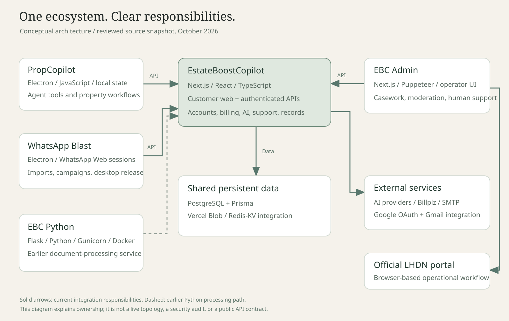
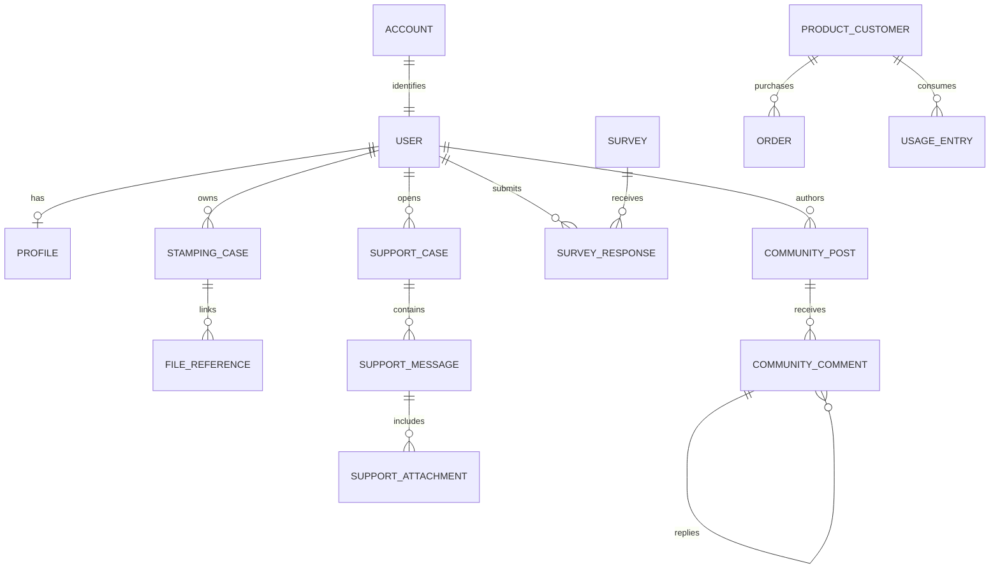
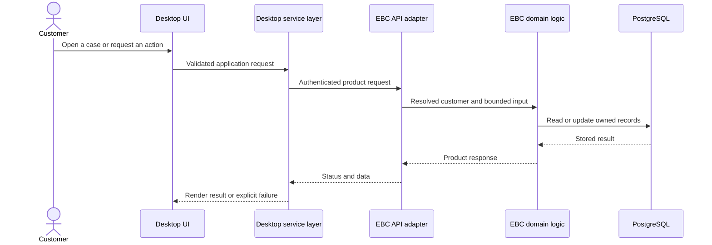

# System architecture

[Showcase home](../README.md) · [Product overview](01-product-and-impact.md) · [Source review](source-review.md)

The ecosystem separates the customer-facing cloud service, operator workflows, desktop execution, and document processing. Repository boundaries track those different runtime needs.

## The five runtime roles

| Component | Runtime | Primary responsibility |
| --- | --- | --- |
| EBC | Next.js / Node.js on Vercel | Web UI, authenticated APIs, shared records, billing, files, and AI integrations |
| EBC Admin | Next.js / Node.js, including local operator use | Work queues, browser automation, human operations, and admin interfaces |
| EBC Python | Flask / Python, with Gunicorn and Docker configuration | Earlier document-processing service and applied-model pipeline |
| WhatsApp Blast | Electron / Node.js desktop | Messaging sessions, local imports, campaigns, and desktop integration |
| PropCopilot | Electron / Node.js desktop | Property workspace, local state, platform automation, and AI-assisted execution |

The Python connection is historical in this view. The current EBC stamping entry point also runs extraction and expansion in TypeScript. A reader should not assume every uploaded PDF still travels through the Flask service.

## Shared cloud data

EBC's Prisma schema defines the main PostgreSQL domain model. Its relevant model families include accounts and profiles, stamping cases, purchases and usage, support, surveys, Community, and shared table/team records.

Files belong in object storage; their relationships and workflow state belong in the database. For example, a stamping case can reference the uploaded agreement, statement, payment artifact, and final certificate. A support attachment relates to a message and a conversation.

This is a simplified relationship diagram. Names such as `FILE_REFERENCE` group a responsibility; they are not a promise that a table with that exact name exists. The actual schema has more models and fields.

## A request crossing product boundaries

The desktop products call EBC through product-specific adapters. EBC resolves the authenticated customer and applies its own ownership and business checks. The desktop does not choose an arbitrary database user to act for.

Support is a concrete example of this shared architecture. The website and PropCopilot access the same case data. Their authentication entry points differ, while common service behavior can stay in the EBC backend.

## The operator boundary

Admin is a working surface for people and browser-based operational tasks. It needs access to case state and files, plus controls for reviewing and completing work. Current admin case, support, survey, Community, and maintenance flows use EBC APIs or proxies.

The codebase also contains legacy utilities. The responsibility model is that EBC owns the authoritative schema and shared domain records; it should not be read as a claim that every historical admin file implements an identical access pattern.

A browser automation process has different constraints from a web request. It may hold a session, navigate a third-party portal, wait for a generated PDF, and need an operator after a failure. Keeping that work in the operator environment makes the boundary visible.

## External integrations

| Integration | Purpose | Boundary that matters |
| --- | --- | --- |
| AI provider APIs | Document extraction, support, and assisted work | Responses need shape checks, bounded time, and usage evidence |
| Billplz | Service purchases and payment flows | A browser redirect and an application record have different roles |
| Google OAuth / Gmail | Account and product connections | Tokens and account-scoped data must remain server-controlled |
| SMTP / email rendering | Notifications, reminders, and file delivery | Delivery is a separate step from generating the underlying artifact |
| Vercel Blob | Agreements, certificates, profile media, and attachments | File references must remain aligned with database ownership |
| KV/Redis integrations | Session and integration support | Environment and connection errors must be distinguished from user input errors |
| External portals and web sessions | Operational and property workflows | UI changes, expiry, and ambiguous outcomes need explicit handling |

## Deployment and distribution

EBC uses Vercel builds and functions. The recorded build pipeline generates Prisma Client and applies deployment migrations before the Next.js build. Environment selection and database migration are therefore operational concerns as well as code concerns.

EBC Python includes Conda configuration, a Dockerfile, and a Gunicorn entry point. The container records a separate deployment approach suitable for Python libraries and model dependencies.

WhatsApp Blast packages the desktop app with Electron Builder. Its GitHub Actions workflow builds Windows and macOS releases from version tags. PropCopilot has its own desktop build and test structure.

These approaches solve different delivery problems: web release, container service, and installed desktop software.

## Architecture trade-offs worth discussing

**One shared backend reduces duplicated business rules.** It also creates a coordination obligation: adapters and clients must understand the same state and response contract.

**Desktop execution provides local access.** It introduces session recovery, local persistence, distribution, and update work that a pure website does not need.

**AI reduces manual interpretation.** It introduces uncertainty, latency, model access, and billing. Explicit validation and review remain necessary.

**Browser automation reaches workflows without a stable product API.** It depends on page state and external UI behavior. A task needs observed completion evidence and an exception path.

**Multiple repositories support different runtimes.** They require careful documentation of ownership, schema changes, and release order.

[Next: the stamping pipeline](03-stamping-case-study.md)
