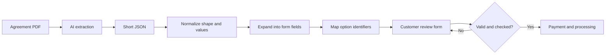

# Case study: agreement PDF to stamping delivery

[Showcase home](../README.md) · [Python history](04-python-and-document-ai.md) · [Admin operations](06-admin-operations.md)

The stamping service demonstrates a complete software workflow. Its input is an agreement document. Its useful outcome is an application processed through the service, with a certificate and clear delivery state.


## 1. Upload and create a traceable case

The frontend creates a case record and uploads the PDF to object storage. The extraction request can then pass the stored PDF URL to EBC. The backend downloads the document for the model call.

This avoids carrying the entire binary through every application step. It also gives the case a persistent link to the uploaded input. Earlier work in the repository addressed serverless payload limits, rather than treating every upload failure as an AI problem.

The inspected frontend has explicit upload, processing, success, and rejection states. A failure must be visible; preparing an empty-looking form is not useful evidence that extraction succeeded.

## 2. Ask AI for a compact data contract

The extraction prompt asks for the agreement date, landlord and tenant details, premises information, rental dates, and rent. It also supports multiple people and up to three stepped rental sessions.

The compact schema represents concepts close to the document. It does not ask the model to generate every downstream form answer and option identifier.

The following is a **synthetic, abbreviated explanation**, not a production payload or a customer record:

```json
{
  "landlord": {
    "name": ["Example Person"],
    "address": [],
    "foreignerNationality": [""]
  },
  "premises": {
    "address": [{ "street": "Example Building, Example Road", "city": "Example City" }]
  },
  "rentalSessions": [
    { "commencementDate": "2026-01-01", "expiryDate": "2026-12-31", "rental": "RM 2000" },
    { "commencementDate": "2027-01-01", "expiryDate": "2027-12-31", "rental": "RM 2200" }
  ]
}
```

## 3. Normalize, expand, and convert

The current TypeScript pipeline has three distinct stages: format the short JSON, generate the larger form representation, and map values to downstream option identifiers. EBC Python contains an earlier implementation of the same broad responsibility.



Separating these stages makes a failure easier to locate. A valid country name can fail option matching. A missing city can fail form validation. Neither necessarily means the model failed to read the PDF.

## The domain rules that make it useful

| Problem | Implemented treatment | Why the distinction matters |
| --- | --- | --- |
| Several landlords or tenants | Align person arrays by index and map them into separate form slots | A phone number or passport must remain tied to the right person |
| A shared value appears once | Indexed-value helpers can reuse a supplied value | Shared contacts or addresses should not disappear from later people |
| Malaysian identification | Format the number and derive supported birth-date/gender fields | Local identity format carries data a passport does not |
| A foreign person | Keep passport, gender, birth date, and nationality as separate extracted fields | Nationality is not the country in the person's postal address |
| Missing personal address | Use premises information under the configured completeness rules | An address object with defaults is not always a usable address |
| Origin-only text such as a region and country | Treat it separately from a complete postal address | Origin information should not block the fallback address rule |
| Country names differ from official options | Normalize text, apply aliases, then compare meaningful tokens | A valid country name may have a different display label |
| Empty city with a multi-part address | Move the final segment only under the guarded comma rule | Preserve enough address content for later splitting |
| Rent changes during the tenancy | Keep one to three start/end/rent sessions | One agreement can contain more than one rent period |

These are software rules with business meaning. They can be inspected and tested separately from the model prompt.

## 4. Make the review step usable

The customer checks a long editable form. The UX therefore needs more than red borders. The reviewed implementation and development record include first-error navigation, a list of incomplete fields, a jump-to-bottom control, compact phone-number entry, and more direct date selection.

Phone autofill is a frontend preference for empty contact fields. It belongs at the review layer, rather than changing the extracted document record. That separation keeps the customer's convenience setting distinct from what the agreement says.

## 5. Connect money to operational work

The workflow separates the company service fee, government stamp duty, payment state, and document artifacts. EBC stores the case and file references. Admin handles operational actions and exceptions.

The reviewed payment helper can create a PDF payment record from Billplz data and upload it to Blob. That should be described as a generated payment artifact, rather than claiming every PDF is an original provider-issued invoice.

Application progress, certificate retrieval, and sending to the customer remain separate states. A payment redirect or a successful browser click alone cannot stand in for the entire chain.

## 6. Deliver and retain a useful record

The final certificate is linked to the case and can be sent through the existing email workflow. The customer dashboard displays progress and completed items. Admin also has a manual sending surface that validates selected cases and makes resend intent explicit.

This is the broader engineering result: the document, structured data, reviewed form, payment, operator work, and delivered file are connected rather than scattered across manual steps.

## Discussion points for an interviewer

- Why use AI for extraction and deterministic rules for expansion?
- How do indexed arrays preserve identity when values are shared or missing?
- How do nationality and address country affect different form fields?
- What should a customer see when extraction fails?
- Which state proves a payment, a submitted application, or a delivered certificate?
- How would you evaluate extraction quality without publishing private agreements?

No extraction-accuracy benchmark or official approval rate is claimed here. The source and interface demonstrate the implementation; a quality benchmark would need a consented, labeled evaluation set.

[Next: Python and document AI](04-python-and-document-ai.md)
