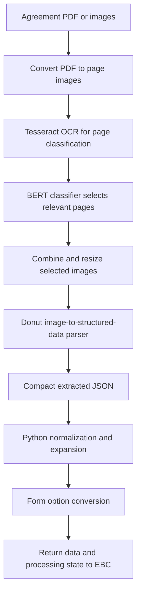

# Python and document AI

[Showcase home](../README.md) · [Stamping workflow](03-stamping-case-study.md) · [Development history](10-history-and-evidence.md)

EBC Python records an earlier processing service and a substantial part of the project's document-engineering work. Its history begins in July 2024. It includes a running-service structure, document preparation, learned-model integration, training artifacts, and deterministic transformation code.

## A Python service with an application boundary

The reviewed service uses Flask. It has a health endpoint, API-key checking for protected requests, CORS configuration, and an upload-processing entry point. That entry point accepts a case identifier, starts processing work, and returns before the processing thread finishes.

Gunicorn and Docker configuration provide a deployment path distinct from the Next.js application. The Conda environment specifies Python 3.12 and the document/model dependencies.

This is an asynchronous threaded service design. It should not be described as a durable queue: a process restart can interrupt in-flight thread work. That trade-off is a useful interview topic because it connects application behavior with runtime guarantees.

## The earlier learned-model pipeline

Two model roles are visible in source:

| Model component | Input | Responsibility |
| --- | --- | --- |
| BERT sequence classifier | OCR text from a page image | Decide whether the page contains relevant table/schedule content |
| Donut / vision encoder-decoder | Prepared document image | Produce structured document output |

The distinction matters. OCR supports the page-classification stage. The Donut parser has its own image-based input path. Calling the whole pipeline either only OCR or only a language-model prompt would miss its structure.

The implementation selects CUDA when available and falls back to CPU. Setup utilities load model/processor artifacts and save local copies. The repository includes separate fine-tuning notebooks for classification and parsing. Their presence demonstrates training work and reproducible-development intent; this showcase does not claim measured model accuracy or publish the private training material.

## Document preparation is part of the model system

The preprocessing layer handles PDF-to-image conversion and image inputs. It filters relevant pages, combines selected images, and resizes them for the parser.

Each choice has a trade-off. Page filtering reduces unrelated content, but a missed page removes evidence. Combining pages preserves more information in one input, but aggressive resizing can lose small text. A robust evaluation would measure those stages separately from final JSON accuracy.

The service also contains document replacement, source download, status update, and result-posting helpers. Those connect inference to a business case rather than leaving it as a notebook demonstration.

## Deterministic Python transformation

After extraction, the Python pipeline formats the short JSON, expands entities and premises into the larger form, and converts values into downstream option identifiers.

| Module family | Work represented |
| --- | --- |
| Dates and agreement dates | Parse varied date strings and normalize the representation |
| Malaysian identification | Format and interpret supported local identity data |
| Passports and registration numbers | Separate identification types and strip irrelevant labels |
| Gender and birth date | Populate the appropriate form fields from explicit or supported derived data |
| Telephone numbers | Normalize contact formats and shared/indexed values |
| Rental amounts | Turn currency strings into a usable value |
| Addresses | Separate components and detect incomplete input |
| People and companies | Choose the relevant form path |
| Foreign persons | Keep origin and identity handling distinct from local-person logic |
| Property categories and floor ranges | Match extracted descriptions to supported form choices |
| Country/state dictionaries | Convert readable labels to the form's identifiers |

The repository also has focused test and comparison scripts for several formatting variants. These show iterative algorithm work. Their filenames and notebook outputs are not a substitute for a reviewed benchmark, so no accuracy percentage is reproduced here.

## Evolution toward provider extraction and TypeScript

The historical Donut path remains in the repository, while the inspected Flask entry point selects the Gemini path. The Dockerfile also notes that the Donut setup step is no longer part of that selected container path.

The later EBC website has its own TypeScript extraction and expansion pipeline. Python history includes a February 2026 commit referring to testing expansion for a TypeScript port. The architecture therefore evolved across three distinct concerns:

1. Learn and integrate document-classification/parsing models.
2. Use a provider model to extract a smaller document contract.
3. Keep the domain transformations explicit and move their implementation where the application needs them.

This is an important engineering story. Changing the extraction technology does not remove the need for dates, identity rules, country matching, validation, or workflow state.

## Evidence from 2024

The recorded Python history includes September 2024 work on agreement dates, gender/birth-date fields, address formatting, contact handling, landlord/tenant processing, and foreign-person classification. [The history chapter](10-history-and-evidence.md) lists selected commits.

These dated records support Python and data-processing experience before 2025. They do not prove which tools were or were not used while writing each change.

## Engineering questions this work prepares me to discuss

- When is classification useful before extraction?
- How does image resolution affect downstream text quality?
- What should be learned by a model, and what should be a deterministic rule?
- How should asynchronous Python work report progress and failure?
- How do you preserve behavior when porting a transformation pipeline to TypeScript?
- What would a versioned, privacy-safe regression dataset need to contain?

[Next: WhatsApp Blast](05-whatsapp-blast.md)
