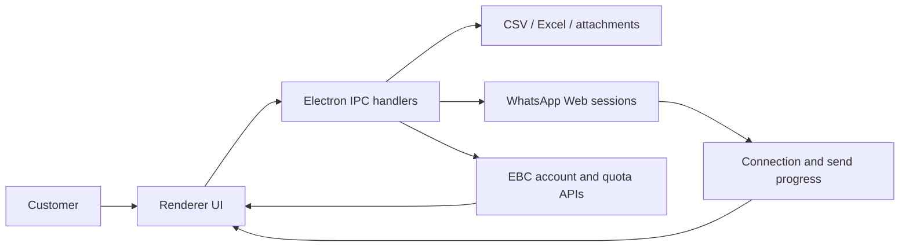
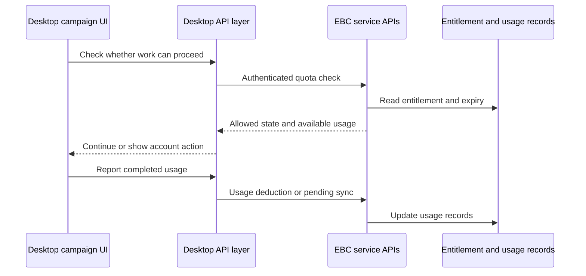

# WhatsApp Blast: desktop software and cloud integration

[Showcase home](../README.md) · [Products](01-product-and-impact.md) · [Payments and reliability](09-payments-data-reliability.md)

WhatsApp Blast is a standalone Electron product connected to EBC for account and entitlement services. The application combines local contact files, message composition, connected account sessions, campaign controls, and usage reporting.

## Responsibilities inside the desktop app

The reviewed source separates the main process from renderer features. The main process owns capabilities such as windows, native file dialogs, account/session integration, updates, and cloud API requests. Renderer modules handle the customer-facing controls and progress.

This division introduces a real interface-design task: UI state and privileged operations need a stable request/response and event contract. A button click should not require the renderer to own every implementation detail.

## The customer workflow

1. Access the product through the EBC-linked account flow.
2. Connect a WhatsApp account and observe its connection state.
3. Import contacts from CSV or Excel, or use the phonebook.
4. Prepare message content, templates, and attachments.
5. Configure accounts, pacing, and any schedule.
6. Start the campaign and monitor progress.
7. Review history and cloud quota information.

Feature modules in the reviewed source cover account controls, imports, contacts, templates, sender behavior, multiple accounts, scheduling, safety checks, history, settings, and referrals.

## Sessions are a product concern

The app integrates `whatsapp-web.js` with local authentication sessions. Session creation, startup restoration, QR interaction, disconnection, and client destruction need explicit handling.

An installed app can retain local state across launches, but a retained session does not guarantee that the upstream service is connected. A useful UI must distinguish account setup, connecting, ready, expired, and failed states where supported.

This integration uses WhatsApp Web behavior. It is not a claim of official WhatsApp Business Platform integration, unrestricted sending, or guaranteed deliverability. Upstream changes remain an external dependency.

## Imports and campaign controls

The Excel handler opens a native file dialog, reads a selected workbook, selects a worksheet, and returns a row representation. CSV import provides another common contact source. File parsing and validation help turn a user's existing material into structured application data.

Multiple-account sending adds another layer. Reviewed UI code contains per-account configuration and fixed, random, or spread-over-time pacing modes. The customer's desired pace and account choice become explicit task settings.

Scheduling, message templates, attachment handling, campaign history, and error displays complete the working experience. These are asynchronous state problems as much as screen-design problems: a campaign can keep running after a configuration panel closes, and a failed send must remain distinguishable from a completed one.

## The EBC quota bridge

The desktop requests quota information from EBC and submits usage deduction. The reviewed quota module also has a path for syncing pending usage deductions.

This describes the integration, not a claim that offline usage is exactly-once or that every historical deduction path has a modern idempotency guarantee. Reliable synchronization and ambiguous network results are important areas to discuss and test.

## Shipping the app

The package includes Electron Builder configuration for Windows and macOS, an update integration, and a public release target. The reviewed GitHub Actions workflow runs on version tags and builds on both operating systems.

The build scripts also include obfuscation and bytecode steps. Those are distribution choices. They do not replace protection of API credentials or server-side authorization.

Shipping desktop software means thinking beyond local development: installation, packaged assets, versioning, updates, operating-system differences, and support when a customer is on an older version.

## What the work demonstrates

This product joins JavaScript UI development, native desktop integration, file processing, session lifecycle, async workflows, cloud entitlements, and release engineering. Its customer journey also depends on the EBC website, purchases, and support. That makes it a useful case study in building and operating a connected product rather than an isolated screen.

[Next: Admin operations](06-admin-operations.md)
