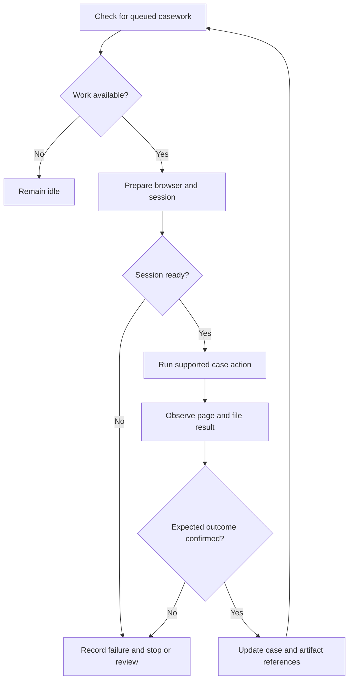

# EBC Admin: the operating side of the product

[Showcase home](../README.md) · [Stamping](03-stamping-case-study.md) · [Community and support](08-community-surveys-support.md)

EBC Admin gives the company a working interface for customer services that continue after the initial web request. It combines case visibility, operational automation, exception handling, communication, and product administration.

## The work operators need to do

| Area | Operator capability |
| --- | --- |
| Dashboard | See work and support cases that require attention |
| Stamping cases | Search records, validate selected cases, and request certificate delivery |
| Task manager | Coordinate supported browser-automation work |
| Payment operations | Review payment-related records and workflow state |
| Community | Review posts, reply, moderate content, handle reports, and prepare FAQs |
| Surveys | Design, preview, publish, stop, resume, and inspect responses |
| Support | Read AI and human cases, take over, reply, close, or return a case to AI |
| Notices and FAQ | Update customer-facing information |
| Maintenance | Preview eligible object-storage cleanup and confirm execution |

These controls are a product surface for the team. They need the same care as customer UI because incorrect actions can affect paid work and customer communication.

## Browser automation as a managed workflow

The reviewed task manager uses Puppeteer and distinct actions for login, application work, certificate retrieval, and clearing saved draft state. It fetches work from EBC and keeps its own running state.

The application form automation includes multiple rental sessions, matching the broader data contract in EBC. This is a practical cross-repository obligation: adding a repeated field to extraction is incomplete until the downstream executor can enter it.

The source also contains payment automation material, while the repository's operating guidance treats automated LHDN payment scheduling as paused. This showcase does not claim every retained script is active in the scheduler.

## Observe an outcome before advancing state

Browser workflows use page navigation, selectors, responses, downloads, and waits. The goal is to connect a business state transition to an observed outcome.

A generated certificate can take longer than a normal page request. A timeout might mean failure, or it might mean the operation finished after the application stopped waiting. A retry policy must account for that ambiguity, especially around paid or externally committed work.

This is why operator visibility and manual completion are necessary. The team needs to see which case, which step, and which artifacts exist before repeating work.

## Manual certificate sending

The current stamping console calls the EBC admin API for case data and sending. EBC owns validation, file references, SMTP delivery, and the corresponding case-state update.

The reviewed design validates selected records before confirmation, checks them again before sending, processes requests in sequence, and treats a resend as an explicit choice. Failed or unsent cases remain visible for follow-up.

That behavior connects UI design with operational correctness. A batch control must explain what it will act on and preserve the unresolved items.

## State-driven administration

Moderation controls follow the current content state. A pinned post needs an unpin action. An active post may be hidden or deleted. Hidden or deleted content has a restore path where supported. Showing every action all the time makes mistakes easier.

The same principle applies to support ownership and survey lifecycle. Operators should see actions that make sense for the current record, with confirmation where an action is consequential.

Admin review state helps reduce repeated work. After a post has been reviewed, the team can focus on new items; enough new activity can bring a thread back for review. This creates a manageable queue for turning recurring issues into FAQs or product improvements.

## Cross-repository consistency

Surveys illustrate the coordination required. The Admin builder, live preview, response view, proxy routes, EBC API, database representation, and customer modal all need the same interpretation of question types and lifecycle.

Publishing, stopping, or resuming a survey must refresh active state and history immediately. A successful write followed by stale UI still looks broken to an operator.

Support and Community have the same challenge. Admin actions need to update the public product's interpretation without forcing the team to understand separate copies of the business logic.

## Maintenance with a preview

The cleanup workflow compares recognized Blob prefixes with current database references. It lists candidates before execution and rescans server-side before deletion. Current profile pictures and stamping files referenced by live records are protected by those checks.

This is a useful example of operation design: the operator chooses a cleanup operation, while the backend determines whether each file is still eligible. Unknown prefixes are not automatically treated as disposable.

The pattern has limits. Reference scans are not the same as a formal object-ownership system, and concurrent uploads can require additional lifecycle rules. The showcase explains the implemented approach rather than claiming universal cleanup safety.

## Engineering value

Admin demonstrates workflow design, browser automation, state-driven interfaces, API proxies, artifact handling, exception reporting, and operational maintenance. It also shows an understanding that a product includes the work the company must perform to deliver its promise.

[Next: PropCopilot integration](07-propcopilot.md)
