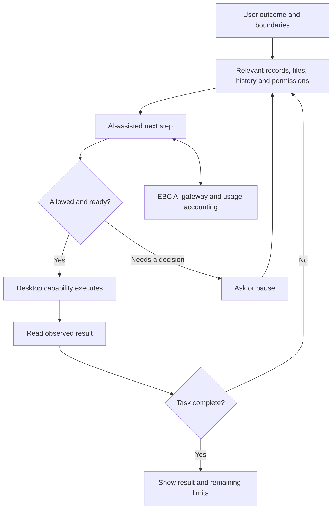
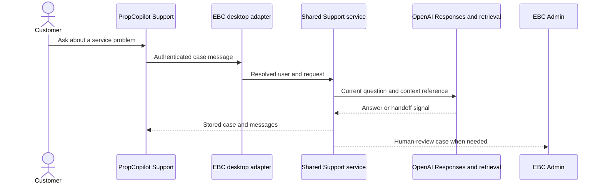

# PropCopilot and the shared EBC backend

[Showcase home](../README.md) · [Dedicated PropCopilot showcase](https://github.com/EstateBoostCopilot/PropCopilot-Showcase) · [Architecture](02-system-architecture.md)

PropCopilot extends EBC into a desktop working environment for property agents. Its scope includes listing information, connected platforms, client-related work, local files, and AI assistance. EBC provides shared cloud capabilities underneath that experience.

## Three responsibilities in an AI-assisted task

| Layer | Responsibility |
| --- | --- |
| Desktop application | Working records, local files, connected sessions, progress UI, and permitted actions |
| EBC backend | Authenticated model access, shared account services, billing, usage records, Community, and Support |
| AI provider | Interpretation, reasoning, structured output, and proposed tool use within the supplied contract |

This division matters when a task changes something. A model can propose the next action. The application must decide whether that action may execute, perform it through the supported capability, and observe its result.

The diagram is a conceptual explanation of the runtime design. It does not claim every possible task is available or that an external action is always reversible.

## Work represented in the desktop source

The reviewed repository has service and UI families for listings, platform connections, tenancy information, messaging, performance, knowledge, agent execution, and task history. It also includes context compilation/retrieval, task-state handling, permission policy, progress reporting, and evaluation/test infrastructure.

Examples of useful engineering concerns include:

- Reconciling information about the same property from several sources.
- Separating a prepared listing change from publication to a connected platform.
- Keeping a local file reference distinct from a cloud business record.
- Handling a logged-out session differently from a timeout or missing page.
- Retaining enough task history to explain what happened.
- Reporting a partial result without claiming the whole task finished.

These concerns connect the agent layer to the underlying product. An assistant is useful when its records, actions, and results mean the same thing to the customer and the application.

## What EBC contributes

The EBC API families support product authentication, AI requests, Gmail connection state, subscription and quota information, usage reporting, runtime incidents, Community, and Support. Shared table/team records and tenancy/stamping integrations provide additional cross-product links.

The reviewed AI backend has provider-specific handling and a common product-facing contract. Requests and attempts need identifiers, statuses, usage records, output limits, and explicit failure behavior. Those are backend responsibilities; desktop UI should not silently reinterpret a billing denial as a disconnected property account.

## Account and support continuity

The desktop support service calls EBC's PropCopilot support endpoints. It passes the product credential, case public identifier, message, and relevant attachment or request information. EBC resolves the customer and uses shared support logic.

The website uses its own authentication entry point into the same backend responsibility. The AI context is controlled server-side, so the client does not need a second implementation of model memory.

## State and billing are part of agent design

A multi-step task can produce several provider attempts and several external actions. It needs more than a single completed/failed boolean.

The source layout and backend ledgers distinguish task execution from usage accounting. AI credits are normalized from configured provider-cost estimates rather than treating all tokens as equivalent. Quota reservation, settlement, and uncertain usage need their own treatment. [The reliability chapter](09-payments-data-reliability.md) develops this point.

## Why the desktop and cloud separation is useful

Local execution provides access to the user's installed workspace and permitted files or sessions. Cloud services provide shared account records, model integration, billing, and company support. Each side can evolve, but its interface has to remain compatible with the other.

That also introduces costs: release coordination, client-version differences, network failure, and recovery after partial work. The architecture is valuable because it gives those issues an explicit place, not because separation eliminates them.

For the wider product tour, UI examples, and its high-level agent workflow, see the [PropCopilot public showcase](https://github.com/EstateBoostCopilot/PropCopilot-Showcase).

[Next: Community, Survey, and Support](08-community-surveys-support.md)
