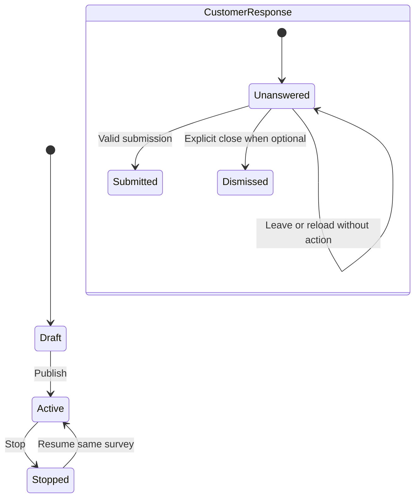
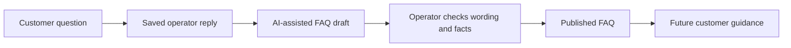

# Community, Survey, and Support

[Showcase home](../README.md) · [Admin operations](06-admin-operations.md) · [Reliability](09-payments-data-reliability.md)

These features form the customer feedback and help layer around EBC's paid services. Each spans user UI, backend behavior, persistent data, and an operator interface.

## Community: reading, participation, and moderation

Community includes posts, comments and nested replies, mentions, search, reactions, polls, views, notifications, reports, and moderation. Public and authenticated surfaces share a core UI, while participation rules are enforced at the relevant endpoints.

The interface follows a single-column feed. Long content has a bounded preview and expansion controls. Comments and the direct comment composer have different controls; opening a discussion should not force a large textarea into every post.

The engineering includes relational links between posts, comments, authors, votes, poll choices, reports, and notifications. Parent-comment relationships represent reply branches. Moderation state must remain consistent when a comment becomes hidden or deleted.

### Ranking and displayed counts serve different purposes

The backend has a hot-score calculation that uses engagement, bounded view contribution, and age. The ranking score helps order posts. Public reaction controls show like and dislike quantities rather than exposing a negative net score as the only number.

Poll behavior has separate rules: a single choice, a locked state after voting, and result percentages displayed at the appropriate point. Backend constraints matter because a disabled UI control alone does not enforce a vote rule.

### Responsive interactions need explicit state

The reviewed UI has optimistic vote updates, pagination, request cancellation, and viewport observation. These solve different latency problems:

| Mechanism | Purpose |
| --- | --- |
| Optimistic update | Show the likely local result immediately while the backend request runs |
| Rollback/error handling | Correct the UI when the write fails |
| Bounded feed pages | Avoid loading every post at initial entry |
| Lazy thread loading | Fetch comment content when it is needed |
| View deduplication | Avoid counting the same person's repeated scroll as repeated independent views |
| Stop-on-error pagination | Prevent a failed request from becoming an endless loading loop |
| Read-state updates | Remove old notification badges after the panel is opened |

These are observable product behaviors, not just performance implementation details. A fast-looking control must still converge to the stored result.

## Surveys: an in-house form system

The in-house schema supports short and long text, single choice, multiple choice, select, rating, number, date, email, and phone questions. Questions can have descriptions, options, validation bounds, and required status.

Admin has a designer, live preview, history, and response view. The customer receives a modal styled to match the product. The live preview must reflect that same renderer contract rather than a different-looking approximation.

The diagram separates survey lifecycle from an individual customer's response. Stopping a survey does not mean deleting its responses. Resuming the same survey keeps existing history. An optional dismissal is an explicit action; leaving a page should not silently consume the opportunity to answer.

Required surveys have a different close rule. Server validation still decides whether a response is acceptable. UI validation helps the customer but cannot be the only check.

## Support: retrieval, account context, and human ownership

The support system combines a chat surface, stored cases and messages, images, AI responses, tool calls, tickets, admin notes, and audit records. A customer can return to previous cases rather than losing the conversation after one exchange.

The OpenAI integration uses a versioned stored prompt with retrieval configuration. It also supports an authenticated account-context function. The backend resolves the logged-in customer for that tool; the model does not get to select an arbitrary user's identifier.

General product answers and account-specific answers need different evidence. Public knowledge can explain a workflow. A payment or application status must come from the owned service context. A tool result can still be unclear, and some actions require an operator.

### Visible history and AI context are separate

The case transcript is stored by EBC. Model continuity uses the Responses API state reference. The reviewed implementation defines a 72-hour idle boundary based on the previous user message. A long-idle follow-up can therefore begin a new AI context while the customer still sees the earlier case messages.

A new case also has a separate context. This avoids tying unrelated problems together merely because they belong to the same account.

### A handoff is a backend transition

When a model requests human review through the recognized signal, the backend records the transition, creates the relevant ticket/message state, and attempts the operator notification. Admin can take over, reply, close a case, and return it to AI where supported.

The customer should not receive a false statement that a human was notified when the notification request failed. Stored case state and email delivery evidence are distinct.

The current source also includes per-turn request keys, AI lease fields, and support budget records. These address duplicate submissions, concurrent generation, and company-funded usage. Their presence is implementation evidence, not a claim that every race or provider failure has been formally verified.

### Images and message responsiveness

The support UI handles text and up to three image attachments per message under its validated contract. Images are compressed in the user-facing flow and stored with case/message references. Registered ownership matters before an uploaded image is attached to a message.

An optimistic message appears immediately after Send, then reconciles with the server result. If sending fails, the message needs an error state instead of disappearing or looking confirmed.

## Turning a resolved question into shared knowledge

The admin workflow can save a reply, request an AI-prepared FAQ draft, let an operator review it, and then create a public FAQ record. The draft is a proposal. Publishing is a separate action.

This connects support operations with product learning. It also shows why cross-repository UI state, API contracts, and publishing controls need to be designed together.

[Next: payments, data, and reliability](09-payments-data-reliability.md)
