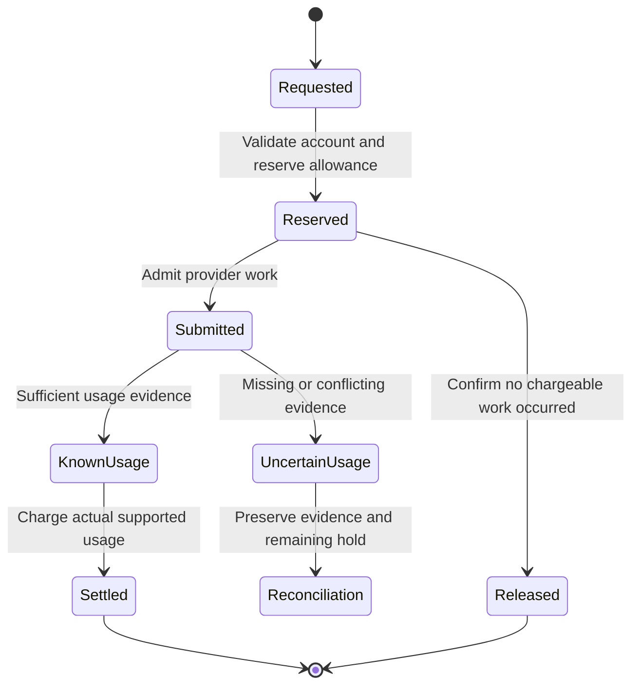

# Payments, data, and production reliability

[Showcase home](../README.md) · [Architecture](02-system-architecture.md) · [History](10-history-and-evidence.md)

The platform combines asynchronous providers, user input, third-party browser workflows, and persistent business records. Reliability comes from preserving the meaning of each operation across those boundaries.

## Payment state belongs to the business record

The stamping workflow has a company service fee and government stamp duty. WhatsApp Blast has product purchases and entitlement periods. PropCopilot adds subscription, usage, and credit records. These represent different business events even when a payment provider is involved in several of them.

The reviewed schema links payment artifacts to their service or order records. The Billplz helper can generate a PDF from retrieved bill/payment data and store the URL. This is useful for later access, but it should not be confused with downloading a provider's original invoice PDF.

A browser return URL is part of the customer journey. A callback is part of server integration. The database records the application's interpretation. An eventual email is another external effect. An engineer needs to keep those roles distinct and verify each relevant boundary.

This chapter describes implementation and design lessons. It is not a payment-security or accounting audit, and it does not assert that every legacy callback has complete signature or replay protection.

## Relational modeling supports the workflows

The schema includes ownership relations, workflow enums, timestamps, identifiers, indexes, and unique constraints. These choices help answer operational questions:

- Who owns this agreement, order, case, or attachment?
- Which state is the record in, and when did activity last occur?
- Has this request already been submitted?
- Which message or case should contain this file?
- Which quota period or purchased credit source funded the work?

The choice between a row, a field, a JSON object, and a Blob URL depends on the responsibility. Long-lived relationships and frequently queried state need a deliberate database representation. A temporary provider payload can have a different storage role.

## Usage accounting for AI

The PropCopilot backend includes quota reservation, usage ledgers, settlement, and credit sources. Provider-specific usage data is normalized using configured cost estimates. Input, output, reasoning, and cache-related fields need the provider's actual accounting interpretation.

This diagram summarizes the responsibility. It is not an exhaustive list of database enum values.

An uncertain provider result must not automatically mean zero cost. A retry can also add cost even if the final user-visible answer comes from only one attempt. The reviewed code and runbook contain attempt accounting, retained reservations, and reconciliation states for such cases.

OpenAI input-count admission is another example: supported work can be checked against an owned reservation before generation. That is a configured-price admission mechanism, not a guarantee about the provider's final invoice or every other provider's cost ceiling.

## Failure classes change the correct response

| Failure | Useful interpretation | Engineering response |
| --- | --- | --- |
| Provider billing/access denial | The project or credential cannot use the service | Report access/billing state; avoid pretending parsing succeeded |
| Transient network/server failure | The request may be retryable under a bounded policy | Retry only within the relevant deadline and cost rules |
| Function deadline | The hosting request ran out of time | Align route limits, provider deadlines, and client expectations |
| Invalid or incomplete model output | The output contract was not met | Validate before expansion and expose a clear failure |
| Paid external action with no confirmed response | The operation may already have occurred | Preserve evidence and require outcome checking before repetition |
| Missing schema field/table | Application and database are out of sync | Check migration target and history, then deploy the intended migration |
| Stale UI after a successful write | The product still displays the old state | Reconcile caches and refresh dependent views |

These distinctions emerged from actual maintenance work. The remedy for slow inference differs from the remedy for a provider 403, an upload limit, or a malformed JSON field.

## Database migrations and environments

Prisma Client generation updates application access code. Migration changes the database schema. Deploying frontend/backend code and applying schema changes are related but separate responsibilities.

The reviewed EBC build script combines client generation, deployment migration, and the Next.js build. Other documented operating flows run migration commands explicitly. The target environment must be clear in either case.

Historical lessons include local/production URL confusion, migration-history mismatch, UTF-8 BOM errors in SQL files, and slow database connection startup. Those problems require targeted checks. Resetting a populated production database is not a routine migration repair.

No database was read or migrated to prepare this showcase. Its evidence comes from source, Git metadata, and supplied screenshots.

## Web and desktop delivery

Vercel route configuration must be statically understandable by the framework. A shared variable used for a route time limit can fail the build where a literal configuration is required. The repository includes documented repairs for this issue.

Git remotes, source repositories, and the Vercel deployment fork also have different roles. The deployment guide records a dual-push arrangement and its limitations: two pushes are not one atomic transaction, and a successful Git push does not prove a successful deployment.

Desktop delivery adds installers, packaged dependencies, version tags, updates, and platform-specific builds. Python delivery adds model/system dependencies, Conda, Gunicorn, and container setup.

## File lifecycle and cleanup

Blob data must stay connected to current business records. Cleanup uses a preview and server-side re-evaluation for recognized file categories. Profile and stamping references are protected through current database links.

This shows a practical maintenance concern: creating files is only part of the implementation. The system also needs rules for retention, replacement, abandoned uploads, case deletion, and orphaned objects.

## The engineering habit behind these repairs

Follow the operation through its actual boundaries. Read the status, payload shape, timing, and stored evidence. Then change the part that owns the failure.

For this ecosystem, that habit means treating a working interface, a successful model reply, a paid bill, a completed browser action, and a delivered document as separate things to confirm. That is the basis for useful progress reporting and safe recovery.

[Next: history and evidence](10-history-and-evidence.md)
