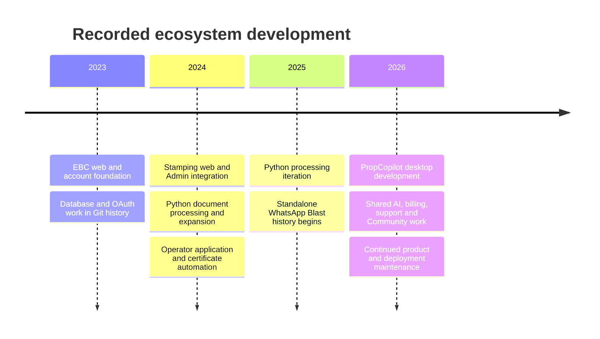
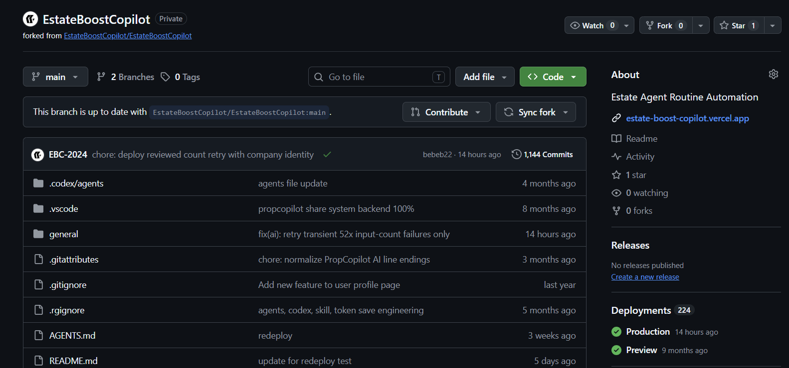

# Development history and evidence

[Showcase home](../README.md) · [Source review](source-review.md) · [Repository snapshot](../evidence/repository-snapshot.json)

The portfolio uses three kinds of evidence: committed Git metadata, selected implementation files, and owner-supplied screenshots. Each supports a different claim.

## Snapshot and counting method

The evidence snapshot was collected on **20 October 2026**, using the full local history of five repositories. EBC Python was read from a separate clone of the private original.

| Repository | Revision prefix | Reachable commits | Non-merge commits | Pre-2025 commits |
| --- | --- | ---: | ---: | ---: |
| EBC | `bebeb22c3960` | 1,144 | 943 | 615 |
| EBC Admin | `288439a17e1b` | 280 | 232 | 56 |
| EBC Python | `53d08026a97e` | 125 | 120 | 43 |
| WhatsApp Blast | `4fef082858cf` | 81 | 80 | 0 |
| PropCopilot | `3b94613c74c2` | 169 | 168 | 0 |
| **Arithmetic total** | | **1,799** | **1,543** | **714** |

`git rev-list --count HEAD` includes merges and all reachable ancestry. The non-merge column excludes merge commits. The pre-2025 column uses Git's `--before` commit-time filter at 1 January 2025 in UTC+08:00. Totals are arithmetic sums across repositories; shared ancestry is not deduplicated.

The script also records author-date ranges. The earliest EBC author date is 3 September 2023. These are dates recorded in Git, not independently verified dates of employment, public release, or customer availability.

The metadata collector records whether the working tree was clean. EBC, Admin, Python, and WhatsApp Blast were clean at collection. PropCopilot had local changes. Its commit statistics describe the recorded revision; observations about current local modules and documents can include later working-tree material. No uncommitted application files were copied into this showcase.

## What existed before 2025

The reviewed history contains **615 EBC**, **56 Admin**, and **43 Python** commits before the cutoff. This is enough to establish substantial earlier project activity without attributing the newer desktop products to that period.



The timeline summarizes source history. It is not a release calendar or a claim that every feature launched in the year of its first commit.

### Selected dated examples

| Repository | Recorded date | Commit | Work indicated by the history |
| --- | --- | --- | --- |
| EBC | 2023-11-03 | `df5fa7a` | SQL structure changes |
| EBC | 2023-11-24 | `d4dd0c9` | OAuth work |
| EBC | 2023-11-26 | `ba691c0` | Prisma client lifecycle and OAuth/login integration |
| EBC | 2024-08-14 | `a1f6963` | Connecting routes with Python and Admin |
| EBC | 2024-08-21 | `c9e2514` | Database workflow status changes |
| EBC | 2024-09-17 | `b11e9cb` | Responsive application and stamping UI |
| Admin | 2024-08-20 | `ea9af29` | Application artifact upload to Blob |
| Admin | 2024-08-21 | `a9364af` | Application automation and value conversion |
| Admin | 2024-08-28 | `a76853c` | Certificate retrieval automation |
| Python | 2024-09-09 | `cf61f69` | Local identification and registration-number formatting |
| Python | 2024-09-10 | `7da1e1a` | Tenant and landlord processing |
| Python | 2024-09-10 | `232f9a7` | Address-formatting work |
| Python | 2024-09-15 | `9cca248` | Gender and birth-date fields |

Descriptions are editorial summaries of recorded commit subjects and relevant source, not quotations of every original message. A commit subject alone does not prove correctness; the source review adds implementation context.

## Henry's contribution and the team

EBC has multiple recorded contributors. This portfolio presents Henry's project and engineering experience while recognizing that shared history includes other people's work.

Two exact author-name strings were counted: `HenryTeo27` and `Henry Teo`.

| Repository | `HenryTeo27` | `Henry Teo` | Combined author-name matches |
| --- | ---: | ---: | ---: |
| EBC | 589 | 14 | 603 |
| EBC Admin | 137 | 12 | 149 |
| EBC Python | 78 | 3 | 81 |
| WhatsApp Blast | 76 | 1 | 77 |
| PropCopilot | 167 | 2 | 169 |

Author names can be configured and can represent aliases. These counts are not verified identities, contribution percentages, lines of code, or quality scores. They also include merges. Commit counts should support an explanation of work, not replace it.

The 2024 integration, Admin automation, and Python-formatting examples above include changes recorded under Henry's author name. An interview can go deeper into those areas while keeping the team's role clear.

## The deployment screenshot



The supplied image displays **1,144 commits** and **224 deployments**. The local EBC commit count agrees with the displayed commit total at the reviewed revision.

The 224 figure is a screenshot observation. It was not queried independently as a live deployment total. GitHub deployment records can include previews, redeployments, and repeated attempts. It should not be restated as 224 unique features or 224 successful production releases.

## What the evidence does and does not show

| Claim | Evidence |
| --- | --- |
| Work spans web, desktop, Python, AI and operations | Reviewed implementation and configuration across five repositories |
| Development began before 2025 | Recorded Git dates and selected historical examples |
| The ecosystem had sustained iteration | Reachable history, non-merge counts, and activity screenshot |
| The supplied customer UI exists | Owner-supplied homepage and application screenshots |
| Henry has a substantial recorded contribution | Exact author-name matches and selected work history |
| A particular feature is correct in every deployed release | Not established by this source review |
| Revenue, customer count, uptime, extraction accuracy or time saved | No measured claim made |
| Which coding tools were used for a historical change | Not established by a commit date |

## Reproducing the metadata

The public [collector script](../scripts/collect-evidence.mjs) reads local Git metadata. It does not copy source, author email addresses, diffs, or machine paths. A reviewer with authorized private checkouts can supply them as arguments:

```text
node scripts/collect-evidence.mjs --date YYYY-MM-DD --repo EBC=PATH_TO_CHECKOUT --repo EBC-Admin=PATH_TO_CHECKOUT
```

This is an example procedure. Reproducing the exact published totals requires the recorded revisions and full reachable history. A later checkout naturally produces a different snapshot.

[Next: interview guide](11-interview-guide.md)
